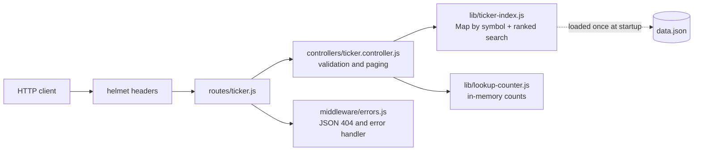

# stock-ticker-lookup-api

A small Express 5 service that answers "which company is this ticker?" and
"what is the ticker for this company?" for about 10,000 US-listed and OTC
securities. It also tracks which symbols have been looked up most since the
process started.

There is no database and no third-party API: the whole dataset ships with the
repository and is held in memory, so the service starts in well under a second
and needs no credentials.

## The data

`data.json` is a snapshot of the SEC's
[`company_tickers_exchange.json`](https://www.sec.gov/files/company_tickers_exchange.json),
which EDGAR publishes from its company registry. Each row gives the company's
CIK (the SEC's Central Index Key), its registered name, the ticker and the
exchange (`Nasdaq`, `NYSE`, `OTC`, `CBOE`, or `null` when EDGAR has none).
The snapshot holds 10,039 rows. When it was taken isn't recorded, so treat it
as indicative rather than current. To refresh it, download the same file from
the SEC (their fair-access policy asks for a descriptive `User-Agent`) and
replace `data.json`. The format is unchanged.

The SEC writes share classes with a hyphen (`BRK-B`). The API also accepts the
dotted form (`BRK.B`) that many brokers use.

## Running it

Requires Node 22 (see `.nvmrc`). npm is the package manager; the project used
to use yarn.

```sh
npm ci
cp .env.example .env   # optional: only sets PORT (default 3000)
npm start
```

`npm run dev` restarts on file changes using `node --watch`.

Or with Docker. The image runs as the unprivileged `node` user and contains
production dependencies only:

```sh
docker build -t stock-ticker-lookup-api .
docker run --rm -p 3000:3000 stock-ticker-lookup-api
```

### Tests and lint

```sh
npm test       # node:test + supertest, no network needed
npm run lint   # ESLint flat config (eslint.config.js)
```

## API

Every response, including errors, is JSON. Errors have the form
`{"error": "..."}`. The examples below were captured from the Docker image.

| Method and path | Purpose |
| --- | --- |
| `GET /ticker/:symbol` | Exact lookup by ticker, case-insensitive |
| `GET /ticker/search?q=&limit=&offset=` | Prefix and partial matching on ticker and company name |
| `GET /ticker/activity?limit=` | Most-looked-up tickers since the process started |

### Look up a ticker

```http
GET /ticker/BRK.B
```

```json
200
{
  "cik": 1067983,
  "name": "BERKSHIRE HATHAWAY INC",
  "ticker": "BRK-B",
  "exchange": "NYSE"
}
```

A well-formed symbol that isn't in the dataset is a 404:

```json
GET /ticker/ZZZZZ  ->  404
{ "error": "Ticker not found", "ticker": "ZZZZZ" }
```

A symbol that can't be a ticker (more than 10 characters, or anything other
than letters, digits, `.` and `-`) is a 400:

```json
GET /ticker/MS$FT  ->  400
{ "error": "Ticker must be 1-10 letters or digits, optionally with '.' or '-'" }
```

### Search

`q` is required (1 to 50 characters after trimming). `limit` defaults to 10 and
accepts 1 to 50. `offset` defaults to 0 and accepts 0 to 10,000.

Matches are ranked in this order:

1. exact ticker
2. ticker prefix
3. company-name prefix
4. ticker substring
5. company-name substring

Within each rank, results keep the SEC file's order, which lists larger
companies first.

```http
GET /ticker/search?q=berkshire&limit=3
```

```json
200
{
  "query": "berkshire",
  "total": 3,
  "limit": 3,
  "offset": 0,
  "results": [
    { "cik": 1067983, "name": "BERKSHIRE HATHAWAY INC", "ticker": "BRK-B", "exchange": "NYSE" },
    { "cik": 1108134, "name": "BERKSHIRE HILLS BANCORP INC", "ticker": "BHLB", "exchange": "NYSE" },
    { "cik": 1067983, "name": "BERKSHIRE HATHAWAY INC", "ticker": "BRK-A", "exchange": "NYSE" }
  ]
}
```

Paging through a broader query:

```http
GET /ticker/search?q=nv&limit=2&offset=1
```

```json
200
{
  "query": "nv",
  "total": 319,
  "limit": 2,
  "offset": 1,
  "results": [
    { "cik": 353278, "name": "NOVO NORDISK A S", "ticker": "NVO", "exchange": "NYSE" },
    { "cik": 1114448, "name": "NOVARTIS AG", "ticker": "NVS", "exchange": "NYSE" }
  ]
}
```

Out-of-range paging values return 400 and the reason:

```json
GET /ticker/search?q=a&limit=500  ->  400
{ "error": "limit must be between 1 and 50" }
```

### Lookup activity

Only successful lookups are counted. They are counted under the canonical
ticker, so `aapl` and `AAPL` add to the same entry. `limit` defaults to 10 and
accepts 1 to 100.

```http
GET /ticker/activity?limit=5
```

```json
200
[
  { "AAPL": 3 },
  { "BRK-B": 1 }
]
```

The counts live in process memory. They reset on restart and are not shared
between instances. That is fine for a demo, but it would need Redis or similar
behind a load balancer.

## How it fits together



Design notes:

- **Load once, index once.** `data.json` is parsed at startup into a `Map`
  keyed by upper-case symbol, so an exact lookup is O(1). Search is a linear
  scan over the 10k rows with pre-uppercased fields. At this size that takes
  a few milliseconds, which is not worth a search index.
- **`createApp()` takes its dependencies.** The ticker index and the activity
  counter can be injected, so each test gets a fresh counter, and a failing
  index can be swapped in to test the 500 path.
- **Errors never leak internals.** Client mistakes get a specific 4xx
  message. Unexpected failures are logged on the server and returned as a
  generic 500.

## License

MIT. See [LICENSE](LICENSE).
